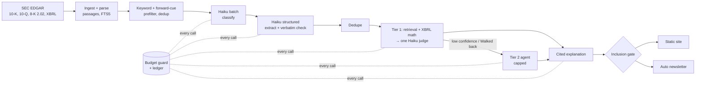

# AIPayback

**Did the AI promises pay off?** Since 2023, public companies have promised a lot from AI: cost savings, margin gains, leaner workforces, new revenue. AIPayback pulls the specific, checkable promises out of SEC filings, checks each one against the company's *later* filings and reported numbers, and publishes a neutral status with citations to both the promise and the evidence.

> Status: **Phases 0–5 built and tested (191 offline tests). Pilot run done for $0.26:** 40 AI promises from 10 companies, checked on the finance lead's rules. Results are a local preview until the finance lead reviews them and the gold labels give the first accuracy numbers. Details: [docs/PROGRESS.md](docs/PROGRESS.md). Plan: [docs/PLAN.md](docs/PLAN.md).
> Informational only. Not investment advice.

## How it works



Statuses: **Delivered**, **On track**, **No evidence yet**, **Walked back** (silent walk-backs are flagged separately). Anything below the confidence threshold is shown as "Status pending review".

## The constraint: $19 of API credit, total

| | |
|---|---|
| App cap (enforced in code) | **$15.00** |
| Locked reserve | $4.00 |
| Spent so far | see `uv run aipb budget` |

- Every call is reserved at its worst case before it is sent.
- The exact cost is logged to a ledger committed in git.
- Outputs are cached so nothing is paid for twice.

- Non-interactive stages use the Batch API (50% off); a batch that outlives its process keeps its reservation until it's collected.
- Every paid command prints its worst case first. Example: classifying the pilot's 868 AI passages is 165 batched requests, **worst case $0.11** (`aipb filter --dry-run`).

Details: [docs/DECISIONS.md](docs/DECISIONS.md) (D1–D5, D20–D22).

## Data so far (pilot run: $0.26 of API credit)

Filings since 2024-01-01. The pilot is 10 S&P 100 companies across 7 sectors, picked by the finance student on 2026-11-11: AMZN, BLK, CAT, FDX, META, MSFT, NVDA, PEP, PFE and TSLA. Eight talk heavily about AI and two (CAT, PEP) are low-AI comparisons. His reason for each pick is in `config/universe/pilot.csv`. The S&P 100 list is in `config/universe/sp100.csv`.

| | Pilot | S&P 100 |
|---|---|---|
| Filings (10-K / 10-Q / earnings 8-K) | 252 (30 / 88 / 134) | 2,395 (293 / 882 / 1,220) |
| Passages (150–400 words, FTS5-indexed) | 17,834 | 179,348 |
| Unique AI passages in 2024–2025 filings (the promise window) | 868 | 3,938 |
| XBRL facts | 90,424 | 905,926 |
| Worst-case cost of the paid pipeline | ≤ $1.53 at 300 promises | ≤ $4.84 at 1,000 promises (breakdown in [docs/PROGRESS.md](docs/PROGRESS.md)) |
| Labeling rows prepared for the finance student | 450 (428 keyword + 22 random for a recall check) | n/a |

The full SEC download (about 4.8 GB with the S&P 100) isn't committed. A manifest with each document's URL and sha256 is, and `aipb restore` rebuilds an identical database from it (checked on a fresh clone).

## Evaluation

| Date | Set | Extraction F1 | Status accuracy | Quote fidelity | Cost / promise |
|---|---|---|---|---|---|
<!-- eval-history:start -->
| 2026-11-12 | dev (257 passages, default) | 36.4% [8.7%, 60.0%] | (Phase 3) | 100.0% | $0.0003 |
<!-- eval-history:end -->

Gold labels come from a finance student and are split into dev and held-out test, grouped by company. Full method: Methodology page (Phase 4).

## Quickstart

```bash
git clone https://github.com/Gavin-Morris-04/aipayback && cd aipayback
cp .env.example .env          # fill in AIPAYBACK_API_KEY and SEC_CONTACT_EMAIL
uv sync && uv run pre-commit install    # or: make setup
uv run aipb doctor            # billing-safety checks; spends nothing
uv run aipb budget            # spent / remaining
uv run aipb restore           # rebuild the local database from committed files (zero API calls)
uv run pytest                 # offline tests
```

### Running the pipeline

Free steps (SEC downloads and code only):

```bash
uv run aipb ingest            # download filings for config/universe/pilot.csv
uv run aipb parse             # passages + FTS index + XBRL facts
uv run aipb prefilter         # AI keywords, forward-looking cues, dedup
uv run aipb stats             # per-company counts
uv run aipb packets           # Excel labeling packets -> exports/packets/
uv run aipb import-labels     # check returned packets -> evals/gold/*.csv
```

Paid steps. Each prints its worst case first; anything over $0.50 needs `--confirm`, and every result is cached, so re-runs are free. `--dry-run` shows the plan without sending:

```bash
uv run aipb filter            # Haiku: promise / hype / none (batched)
uv run aipb extract           # Haiku: statements with verbatim-checked quotes; dedupe
uv run aipb verify            # Tier 1 judge for every promise; Tier 2 agent for escalations
uv run aipb explain           # cited explanations; then the inclusion gate
```

Evaluate, publish and share ($0):

```bash
uv run aipb split && uv run aipb eval        # dev split; --split test --milestone "..." for test
uv run aipb compare                          # A/B table (cost per F1 point)
uv run aipb status-packets / import-statuses / eval-status   # status labels and accuracy
uv run aipb publish && uv run aipb site      # data/site -> site/dist (open index.html)
uv run aipb newsletter-preview               # render this month's issue locally
uv run aipb findings                         # docs/FINDINGS.md
```

Add `--universe sp100` for the S&P 100 (or `make <target> U=sp100`), and `-t TICKER` for one company. Every command has `--help`.

### Automation (off until enabled)

| Workflow | What it does | Turn on with |
|---|---|---|
| `ci.yml` | lint + 191 offline tests on every push | always on |
| `deploy-site.yml` | build the site from `data/site/` and deploy to GitHub Pages | repo variable `SITE_DEPLOY=true` |
| `newsletter.yml` | stage on the 1st, send on the 2nd (hold label, kill switch, ramp-up) | `NEWSLETTER_ENABLED=true` (+ `NEWSLETTER_AUTOSEND=true` for real sends) |
| `monitor.yml` | monthly: new filings → paid stages (guarded) → publish | `MONITOR_ENABLED=true` |

**Never set `ANTHROPIC_API_KEY`.** Claude Code would bill it instead of your Claude subscription. The app uses `AIPAYBACK_API_KEY`.

## Limitations (v1)

- SEC filings only. No earnings-call transcripts or news.
- Promises from filings dated 2024-01-01 to 2025-12-31. Late-2025 promises have a short evidence window.
- A status describes what later filings report. It is not a judgment of management, and it is not investment or legal advice.

## Repo map

`src/aipb/` code: `sec/` EDGAR client · `parse/` HTML to passages · `stages/` filter, extract, dedupe, explain and runners · `verify/` retrieval, numbers, Tier 1 judge, Tier 2 agent, gate · `evals/` metrics and reports · `labeling/` Excel packets and imports · `site/` static site · `newsletter/` issue, intro fact-check, Buttondown and GitHub flow · `budget/` and `llm/` cost control.
`config/` prices, budget, stages, keywords, evidence map, site, newsletter, company lists · `prompts/` versioned prompts · `data/` committed ledger, batch log, filings manifest, LLM outputs, site data, send log · `evals/` gold labels, packet keys, splits, results · `docs/` plan, progress, decisions, interview notes, findings, `finance/` rubric and guides · `gtm/` outreach, discovery, ROI, solution brief, demo, pilot proposal, objections, LinkedIn drafts.
