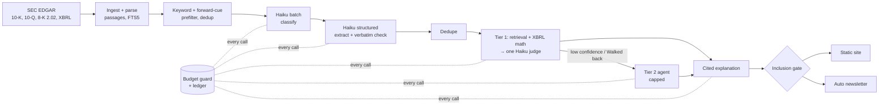

# AIPayback

**Did the AI promises pay off?** Since 2023, public companies have promised a lot from AI: cost savings, margin gains, leaner workforces, new revenue. AIPayback pulls the specific, checkable promises out of SEC filings, checks each one against the company's *later* filings and reported numbers, and publishes a neutral status with citations to both the promise and the evidence.

> Status: **Phase 1 (pilot ingestion, labeling packets, outreach kit)**. See [docs/PROGRESS.md](docs/PROGRESS.md) and [docs/PLAN.md](docs/PLAN.md).
> Informational only. Not investment advice.

## How it works



Statuses: **Delivered**, **On track**, **No evidence yet**, **Walked back** (silent walk-backs are flagged separately). Anything below the confidence threshold is shown as "Status pending review".

## The constraint: $19 of API credit, total

| | |
|---|---|
| App cap (enforced in code) | **$15.00** |
| Locked reserve | $4.00 |
| Spent so far | see `uv run aipb budget` |

- Every call is reserved at its worst case before it is sent.
- The exact cost is logged to a ledger committed in git.
- Outputs are cached so nothing is paid for twice.

Details: [docs/DECISIONS.md](docs/DECISIONS.md) (D1–D5).

## Data so far (Phase 1, $0 of API credit)

Pilot universe: 10 S&P 100 companies across 7 sectors (a **placeholder** list until the finance student picks; see [docs/finance/PILOT_PICKER.md](docs/finance/PILOT_PICKER.md)). Filings since 2024-01-01:

| | Count |
|---|---|
| Filings (10-K / 10-Q / earnings 8-K) | 236 (30 / 87 / 119) |
| Passages (150–400 words, FTS5-indexed) | 18,381 |
| Passages mentioning AI (keyword filter) | 1,396, or 1,128 after removing repeated boilerplate |
| Unique AI passages in 2024–2025 filings (the promise window) | 688 |
| XBRL facts | 99,706 |
| Labeling rows prepared for the finance student | 450 (428 keyword + 22 random for a recall check) |

The full SEC download is about 555 MB and isn't committed. A manifest with each document's URL and sha256 is, and `aipb restore` rebuilds an identical database from it (checked on a fresh clone).

## Evaluation

| Date | Set | Extraction F1 | Status accuracy | Quote fidelity | Cost / promise |
|---|---|---|---|---|---|
<!-- eval-history:start -->
| (Phase 2) | | | | | |
<!-- eval-history:end -->

Gold labels come from a finance student and are split into dev and held-out test, grouped by company. Full method: Methodology page (Phase 4).

## Quickstart

```bash
git clone https://github.com/Gavin-Morris-04/aipayback && cd aipayback
cp .env.example .env          # fill in AIPAYBACK_API_KEY and SEC_CONTACT_EMAIL
uv sync && uv run pre-commit install    # or: make setup
uv run aipb doctor            # billing-safety checks; spends nothing
uv run aipb budget            # spent / remaining
uv run aipb restore           # rebuild the local database from committed files (zero API calls)
uv run pytest                 # offline tests
```

The free data pipeline (SEC downloads only, no API calls):

```bash
uv run aipb ingest            # download filings for config/universe/pilot.csv   (make ingest)
uv run aipb parse             # passages + FTS index + XBRL facts                (make parse)
uv run aipb prefilter         # AI keywords, forward-looking cues, dedup         (make prefilter)
uv run aipb stats             # per-company counts table                         (make stats)
uv run aipb packets           # Excel labeling packets -> exports/packets/       (make packets)
uv run aipb import-labels     # check returned packets -> evals/gold/*.csv       (make import-labels)
```

Add `--universe sp100` (or `make ingest U=sp100`) for another company list, and `-t TICKER` for one company.

**Never set `ANTHROPIC_API_KEY`.** Claude Code would bill it instead of your Claude subscription. The app uses `AIPAYBACK_API_KEY`.

## Limitations (v1)

- SEC filings only. No earnings-call transcripts or news.
- Promises from filings dated 2024-01-01 to 2025-12-31. Late-2025 promises have a short evidence window.
- A status describes what later filings report. It is not a judgment of management, and it is not investment or legal advice.

## Repo map

`src/aipb/` code (`sec/` EDGAR client, `parse/` HTML to passages, `stages/` pipeline steps, `labeling/` packets and import, `budget/` and `llm/` cost control) · `config/` prices, budget, stages, keywords, company lists · `prompts/` versioned prompts · `data/` committed ledger, filings manifest and LLM outputs · `evals/` gold labels, packet keys and results · `docs/` plan, decisions, interview notes, `finance/` rubric and guides · `gtm/` outreach, discovery and ROI kit.
