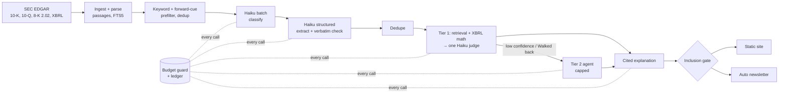

# AIPayback

**Did the AI promises pay off?** Since 2023, public companies have promised a lot from AI: cost savings, margin gains, leaner workforces, new revenue. AIPayback pulls the specific, checkable promises out of SEC filings, checks each one against the company's *later* filings and reported numbers, and publishes a neutral status with citations to both the promise and the evidence.

> Status: **Phase 0 (setup, billing safety, budget guard)**. See [docs/PROGRESS.md](docs/PROGRESS.md) and [docs/PLAN.md](docs/PLAN.md).
> Informational only. Not investment advice.

## How it works



Statuses: **Delivered**, **On track**, **No evidence yet**, **Walked back** (silent walk-backs are flagged separately). Anything below the confidence threshold is shown as "Status pending review".

## The constraint: $19 of API credit, total

| | |
|---|---|
| App cap (enforced in code) | **$15.00** |
| Locked reserve | $4.00 |
| Spent so far | see `uv run aipb budget` |

- Every call is reserved at its worst case before it is sent.
- The exact cost is logged to a ledger committed in git.
- Outputs are cached so nothing is paid for twice.

Details: [docs/DECISIONS.md](docs/DECISIONS.md) (D1–D5).

## Evaluation

| Date | Set | Extraction F1 | Status accuracy | Quote fidelity | Cost / promise |
|---|---|---|---|---|---|
| (Phase 2) | | | | | |

Gold labels come from a finance student and are split into dev and held-out test, grouped by company. Full method: Methodology page (Phase 4).

## Quickstart

```bash
git clone https://github.com/Gavin-Morris-04/aipayback && cd aipayback
cp .env.example .env          # fill in AIPAYBACK_API_KEY and SEC_CONTACT_EMAIL
uv sync && uv run pre-commit install    # or: make setup
uv run aipb doctor            # billing-safety checks; spends nothing
uv run aipb budget            # spent / remaining
uv run aipb restore           # rebuild the local database from committed files (zero API calls)
uv run pytest                 # offline tests
```

**Never set `ANTHROPIC_API_KEY`.** Claude Code would bill it instead of your Claude subscription. The app uses `AIPAYBACK_API_KEY`.

## Limitations (v1)

- SEC filings only. No earnings-call transcripts or news.
- Promises from filings dated 2024-01-01 to 2025-12-31. Late-2025 promises have a short evidence window.
- A status describes what later filings report. It is not a judgment of management, and it is not investment or legal advice.

## Repo map

`src/aipb/` code · `config/` prices, budget, stage settings · `prompts/` versioned prompts · `data/` committed ledger and LLM outputs · `evals/` gold labels and results · `docs/` plan, decisions, interview notes · `gtm/` customer-facing kit.
