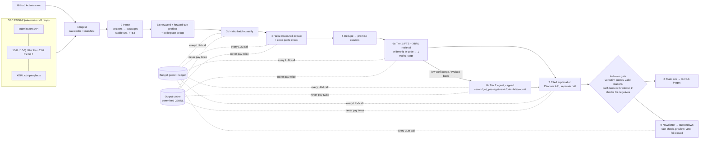

# AIPayback: Implementation Plan

## Context

AIPayback checks whether the AI promises public companies made in SEC filings (2024–2025) paid off, using their later filings. It publishes neutral, cited scorecards and sells small products on top of them. In priority order, the project exists to (1) produce real Forward Deployed, Solutions and AI Transformation engineering evidence for Gavin's May 2027 job search, (2) be accurate, (3) earn some real money, and (4) produce one or two defensible LinkedIn findings. The hard constraint is **$19 of API credit in total**: a $15 app cap enforced in code and a $4 reserve.

**Decisions locked in during planning (2026-11-10):**
- Claude Code bills the subscription plan. Checked: `ANTHROPIC_API_KEY` is unset at the process, user and machine levels. The app's key is `AIPAYBACK_API_KEY`, kept in `.env` and passed explicitly to `Anthropic(api_key=...)`.
- **Contact email:** a new shared project Gmail, used for the SEC User-Agent, Buttondown, Stripe and public error reports.
- **Hosting:** GitHub Pages. The repo is **private while building and goes public at the Phase 5 launch**, after a secret scan of the full history and the finance student's consent to publish the gold labels.
- **Finance-student handoff:** a shared Google Drive folder holding `.xlsx` packets with dropdowns. The CS student drops returned files into the repo, and `aipb import-labels` validates them.
- **Project folder:** `C:\Users\g04mo\aipayback`, remote `Gavin-Morris-04/aipayback` (private). Neither exists yet.

**Verified facts behind this plan** (checked again in Phase 0 and stored in `config/pricing.yaml` with the date):

| Item | Value |
|---|---|
| `claude-haiku-5-5` | $0.10 in / $0.50 out per MTok for prompts ≤100k tokens; **$0.50 / $2.50 above 100k** |
| `claude-sonnet-5-5` | $2 in / $10 out per MTok |
| Batch API | 50% off |
| Prompt caching | writes ~1.25×, reads ~0.1×; minimum cacheable prefix on Haiku/Sonnet 5.5 is 512 tokens |
| Haiku 5.5 thinking | Adaptive thinking is **on by default** at effort `medium`, and thinking tokens bill as output. Every stage therefore sets thinking or effort explicitly; `disabled` is allowed at effort high or below. Prefill is not supported. Refusals have no server-side fallback. |
| Citations vs structured outputs | Can't be combined in one call (returns a 400), so cited explanations are a separate step |
| Forced `tool_choice` | Returns a 400 on Sonnet 5.5, so agents use `auto` plus `strict: true` tools plus an instruction |
| SEC fair access | Up to 10 requests per second; descriptive User-Agent with a contact email |
| Buttondown | Free for the first 100 subscribers. **Paid subscriptions and tagging are $9/month add-ons each.** |
| Local tooling | git, gh (logged in as Gavin-Morris-04, `repo` + `workflow` scopes), uv 0.13.6 (this machine needs `--system-certs`), Python 3.12.10, node. **`make` is not installed.** |

---

## 1. Architecture



**Core principles:**
- **Code first.** Keyword filters, FTS5, XBRL numbers and arithmetic run as plain code. The LLM only classifies, extracts and judges.
- **One gateway.** `aipb.llm.client` is the only module that constructs the SDK client. Every call goes through budget reserve → cache lookup → call → ledger settle → JSONL write.
- **Idempotent and resumable stages.** Each stage keys its work on content hashes and skips anything already done.
- **CI never calls the network or spends money.** It runs in `--offline` mode, where a cache miss raises an error instead of calling the API.

## 2. Data model (SQLite; rebuildable from committed JSONL plus a fresh SEC download)

| Table | Key columns |
|---|---|
| `companies` | cik PK, ticker, name, sector, universe (`pilot`/`sp100`), source, source_date |
| `filings` | accession PK, cik, form, filing_date, period, items (8-K), primary_doc, exhibit_doc, raw_path, sha256, parser_version |
| `passages` + `passages_fts` (FTS5) | passage_id PK = `{cik}-{accession}-{section}-{seq:04d}`, section, text, text_sha256, char_start/end, kw_hits, fwd_cues, dup_of |
| `xbrl_facts` | (cik, tag, unit, period_end, accession) PK, period_start, fy, fp, form, value, filed |
| `classifications` | (text_sha256, prompt_version, model) PK, is_ai, forward_looking, kind, confidence |
| `promises` | promise_id PK, passage_id, quote, quote_span, quote_verified, claim_type, metric, target_value, target_unit, baseline, deadline, deadline_precision, specificity 1–3, kind (`promise`/`hype`), confidence, prompt_version, model |
| `promise_clusters` | cluster_id PK, canonical_promise_id, cik, claim_type, first_stated, restatement count |
| `evidence` | evidence_id PK, cluster_id, source (`passage`/`xbrl`/`calc`), ref, retrieval_method, rank |
| `verdicts` | verdict_id PK, cluster_id, tier (1/2/second_check), status, silent_walkback, confidence, computed_numbers (JSON), evidence_ids (JSON), prompt_version, model |
| `explanations` | cluster_id, text, citations (JSON), citations_valid, prompt_version, model |
| `published_items` | cluster_id, status, first_published, last_changed, change_reason (`new_evidence`/`correction`) |
| `error_reports` | report_id, cluster_id, status (open/closed), received, notes. Loaded from committed `data/error_reports.csv`. |
| `llm_calls` | call_id PK, run_id, stage, model, prompt_version, input_hash, is_batch, batch_id, in/out/cache_read/cache_write tokens, latency_ms, cost_usd, status |
| `runs` | run_id, command, est_cost, actual_cost, git_sha, status, started/finished |
| `newsletter_sends` | issue_key PK (e.g. `free-2026-12`), tier, item_ids, platform_email_id, status, sent_at |
| `gold_*` | loaded from `evals/gold/*.csv` |

**Committed (the source of truth across devices):**
- `data/ledger/llm_calls.jsonl`: append-only, merged with `merge=union` in `.gitattributes`, so the budget follows every device and the cron job.
- `data/outputs/<stage>/<cik>.jsonl`: all LLM outputs, keyed by (input hash, prompt version, model).
- `data/manifests/filings.jsonl`: accession, URL and sha256 for every filing.
- `data/error_reports.csv`, `data/sends/newsletter_log.jsonl`.
- Passage text isn't committed; `make restore` re-downloads and re-parses it.

The committed data is expected to stay well under 50 MB, split per company. Git LFS gets proposed only if a single file grows past ~5 MB.

## 3. Repo structure

```
aipayback/
  CLAUDE.md  README.md  Makefile  pyproject.toml  uv.lock  .env.example  .gitignore  .gitattributes  .pre-commit-config.yaml
  .github/workflows/  ci.yml  monitor.yml  newsletter.yml  deploy-site.yml  secret-scan.yml
  config/   pricing.yaml  stages.yaml (model, thinking/effort, max_tokens, batch per stage)  keywords.yaml  universe/{pilot,sp100}.csv
  prompts/  filter/v1.md  extract/v1.md  verify_t1/v1.md  verify_t2/v1.md  explain/v1.md  newsletter_intro/v1.md
  src/aipb/ cli.py settings.py db.py
            budget/ (pricing, estimator, guard, ledger)   llm/ (client, cache, batch, schemas)
            sec/ (client, ciks, filings, xbrl)            parse/ (html, sections, passages, fts)
            stages/ (prefilter, filter, extract, dedupe, explain, publish)
            verify/ (retrieval, metrics, calc, tier1, tier2_agent, second_check)
            evals/ (split, match, metrics, report)        labeling/ (packets_xlsx, import_labels)
            site/ (build, templates/, static/)            newsletter/ (build, factcheck, gate, buttondown, preview)
            findings.py   mcp_server/ (Phase 6)
  data/     ledger/ outputs/ manifests/ sends/ error_reports.csv     (ignored: data/raw/, data/aipb.sqlite, exports/)
  evals/    gold/{passages,promises,statuses}.csv  gold/returned/  splits.json  results/<ts>_<sha>.{json,md}
  tests/    fixtures/sec/  unit/  integration/  snapshots/
  docs/     BRIEF.md PLAN.md PROGRESS.md DECISIONS.md INTERVIEW_NOTES.md FINDINGS.md METHODOLOGY.md
            finance/ RUBRIC.md EVIDENCE_MAP.md LABELING_GUIDE.md PILOT_PICKER.md
  gtm/      outreach/ discovery/ (GUIDE.md, NOTES_TEMPLATE.md, SYNTHESIS.md) SOLUTION_BRIEF.md DEMO_SCRIPT.md
            PILOT_PROPOSAL.md OBJECTIONS.md ROI_PLAN.md linkedin/
```

**CLI and Makefile.** A typer CLI `aipb` holds all logic. Each Makefile target is a one-line `uv run aipb …`, so every command also works without make:
- `setup`, `restore`, `ingest`, `parse`, `prefilter`, `filter`, `extract`, `dedupe`, `verify`, `explain`, `publish`, `site`
- `eval`, `budget`, `cost-report`, `findings`
- `packets`, `import-labels`
- `newsletter-preview`, `newsletter-send`
- `test`, `lint`

On Windows, the CS student runs `winget install ezwinports.make` once (I'll confirm the package ID in Phase 0). Until then, run `uv run aipb <cmd>`.

## 4. Budget

### 4.1 Guard design (Phase 0, before any LLM call)
- **Pricing:** `pricing.yaml` holds per-model input, output, cache write and cache read prices, the >100k tier and the batch multiplier, with a `verified_on` date. A unit test recomputes costs by hand.
- **Reserve then settle:** before a run, the guard reserves the worst case (input tokens + `max_tokens` output per request, at batch or interactive prices) and refuses if spent + reserved would exceed $15. Afterwards it settles the actual cost from `usage`.
- **Estimates:** a chars-per-token heuristic, calibrated against the free `count_tokens` endpoint on a sample, is printed before every run.
- **Confirmation and refusals:** runs over $0.50 need `--confirm`. Any single prompt over 100k tokens is refused (the 5× price tier).
- **Reserve:** the $4 reserve can only be unlocked by editing `config/budget.yaml`, which needs the CS student's explicit approval.
- **Second, independent guard:** a Console workspace spend limit, set by the CS student (suggested $5/month, raised with approval only in the S&P 100 month).
- **Ledger checks:** the ledger is reconciled against Console usage at the end of every phase.
- **Key safety:** at startup the app warns if `ANTHROPIC_API_KEY` is set, and the client never reads it.

### 4.2 Cost levers, each measured before and after
- Batch API for every non-interactive stage.
- Prompt caching on system prompt, schema and few-shot prefixes (≥512 tokens).
- Deterministic boilerplate dedup: 10-Qs repeat 10-K risk-factor text. Exact plus near-duplicate hashing should skip roughly 30–50% of passages.
- A forward-looking-cue prefilter.
- Packing about 10 passages per classify request.
- Thinking off or low effort, chosen per stage by eval.
- Tight `max_tokens`.
- Tier 2 only for escalations.

### 4.3 Budget table (estimates; recomputed from real pilot numbers at the end of Phase 3)

Pilot assumptions:
- 10 companies, about 240 filings, about 1,400 keyword passages (about 900 after dedup).
- About 25% of passages go on to extraction.
- About 100 promise clusters.
- Haiku batch prices: $0.05 in / $0.25 out per MTok.

| Line | Basis | Est. |
|---|---|---|
| Phase 0 smoke tests | a handful of tiny calls | $0.05 |
| Dev iteration (pilot filter + extract, ~5 prompt versions) | ~$0.15 per full pilot pass × 5, plus partial reruns | $1.50 |
| Evals (Haiku, ~15 runs on gold) | ~$0.10 per run; cached items are free | $1.50 |
| Haiku vs Sonnet 5.5 A/B (hard cap) | Sonnet batch on the dev set: extraction ~150 passages plus ~30 verdicts | $1.50 |
| Phase 3 verification (pilot Tier 1 + capped Tier 2 + explanations, with iterations) | Tier 1 ~$0.06 and explain ~$0.05 per pass; Tier 2 ≤$0.02 per escalation | $1.50 |
| S&P 100 run (needs its own approval) | ~10× the pilot corpus after dedup, plus 2nd checks; recomputed after the pilot | $5.00 |
| Monthly monitoring + newsletters (~6 months) | new passages ~$0.10–0.20 per month; ≤$0.05 per issue | $2.00 |
| Pro deep checks / partner demos | Tier 2 on request | $0.50 |
| Contingency inside the cap | | $1.45 |
| **App cap (enforced)** | | **$15.00** |
| **Reserve (locked)** | | **$4.00** |

## 5. Stage design highlights

- **Ingest:**
  - Tickers map to CIKs through `company_tickers.json`.
  - The submissions API lists filings, filtered to 10-K, 10-Q and 8-K with Item 2.02. EX-99.1 is found through the filing index.
  - XBRL comes from `companyfacts`.
  - A token bucket holds requests at 8 per second, with backoff on 429/503 and a disk cache. The User-Agent is `AIPayback/0.1 (<project Gmail>)`.
- **Parse:**
  - HTML and iXBRL are converted to text (lxml).
  - Item sectioning uses regexes with fallbacks; tables become compact text.
  - Passages are 150–400 words on paragraph boundaries, with stable IDs and an FTS5 index.
- **Filter:** a keyword lexicon plus forward-looking cues feeds a batched Haiku classify step (thinking disabled, `max_tokens` ≈200).
- **Extract:**
  - Haiku runs with structured outputs (`output_config.format`) at low effort; low effort is A/B tested against thinking off.
  - Code verifies every quote verbatim after documented normalization (NFKC, straight quotes, collapsed whitespace, soft hyphens removed). If a quote fails, it gets one retry, then the promise is dropped.
- **Dedupe:** deterministic clustering on same CIK, same claim type, similar metric and target, and text similarity ≥ threshold. The earliest statement is canonical.
- **Tier 1 verify:**
  - Retrieval: FTS5 BM25 over later filings for the same CIK (top 8), plus the XBRL tags from `EVIDENCE_MAP.md`.
  - Code computes the deltas, margins and YoY numbers.
  - One Haiku judge call (structured outputs) returns status, confidence and the evidence IDs it used.
  - Code then validates that the evidence IDs exist and that any numbers come from the computed table.
- **Tier 2 agent:**
  - A manual tool loop, so every turn is logged and capped: ≤8 turns and ≤60k tokens per promise, plus a run-level dollar cap.
  - Strict tools: `search_company_filings`, `get_passage`, `get_reported_metric`, `calculate`, `submit_verdict`. `tool_choice` is `auto` plus an instruction.
  - If there's no `submit_verdict` call, the result is "inconclusive" and isn't published.
  - It runs only on low-confidence Tier 1 cases, on every "Walked back" (as the second check) and on Pro deep checks.
- **Explain:** a separate batch call with the promise and evidence passages as `document` blocks with citations enabled. Code checks that each `cited_text` is a substring of its source. Output is neutral, 2–4 sentences.
- **Neutral-language lint:** a banned-word list ("failed", "misled", "broke", and others) is checked by code on every piece of generated text.
- **Publishing rule:** below-threshold items appear as "Status pending review" with the verified quote only.

## 6. Evaluation

- **Labeling packets:**
  - Built from the keyword prefilter, never from model output.
  - Each packet also holds a ~5% random sample of non-keyword passages, so the prefilter's recall can be measured.
  - Sized for 6–8 hours, about 450 rows.
  - Files are `.xlsx` with dropdowns, frozen headers and SEC links.
- **Split:** grouped by company (prevents leakage from restated promises), seeded and stratified by sector, roughly 6 dev / 4 test companies. The split is frozen in `evals/splits.json`. Test numbers are reported only at milestones.
- **Metrics:**
  - Extraction: precision, recall and F1. A match is the same passage with quote span IoU ≥0.5. Field-level accuracy is measured on matched pairs.
  - Status: accuracy, per-class recall, confusion matrix, and **published precision versus coverage** at the confidence threshold.
  - Quote fidelity: must be 100%.
  - Cost and latency per promise.
  - Bootstrap 95% confidence intervals, since the samples are small.
- **Outputs and CI:** `make eval` writes `evals/results/<ts>_<sha>.{json,md}` and appends to the README history table. CI replays a tiny cached subset offline.
- **Disagreement review:** after each eval run, an xlsx of disagreements goes to the finance student. Each row gets one of: model wrong, label wrong, or rubric unclear.
- **Production monitoring:** each month, 20 randomly sampled published items go to the finance student. The production accuracy rate is tracked next to the offline numbers.

## 7. Website and newsletter

**Website:**
- A static site built with Python + Jinja2, plus a little vanilla JS for sorting the leaderboard.
- Pages: Home (stats, leaderboard, signup), one page per company, one page per promise (quotes, evidence, cited explanation, SEC links), Methodology (rubric, eval table, limitations, errors), Pricing, About.
- SEO: sitemap.xml, canonical URLs, OpenGraph tags, JSON-LD Dataset. The footer carries the not-investment-advice disclaimer.
- **Deploy:**
  - If the CS student has GitHub Pro (free with the Student Developer Pack): `actions/deploy-pages` from the private repo.
  - Otherwise: an Action pushes only the built `dist/` to a small public repo `aipayback-site`.
  - Cloudflare Pages is a one-workflow fallback in case GitHub Pages' commercial-use terms become a problem.
- **Analytics:** Cloudflare Web Analytics (free, cookieless JS beacon).
- **Error reports:** a pre-filled mailto to the project Gmail until the repo goes public, then a GitHub issue form as well.

**Newsletter (Buttondown):**
- Starts on the free tier.
- Templates carry the content. Haiku writes only the intro, from structured data, with a cap of $0.05 per issue.
- Code fact-checks every number, ticker, company name, date and status. On a mismatch it regenerates once; if that also fails, the issue goes out template-only.
- Inclusion gate, a corrections section, a 24-hour preview as a GitHub issue plus a test send to the founders, a `hold` label to veto, the `NEWSLETTER_AUTOSEND` repo variable, idempotent issue keys, a committed send log, and fail-closed behavior throughout. All as in brief §9.1.
- The finance student isn't on GitHub. They can veto by messaging the CS student, or optionally get a GitHub account with Triage access so they can add the `hold` label themselves.
- **Pro:** stays a waitlist until at least 2 people commit, since the paid-subscriptions add-on costs $9/month. Watchlist alerts use a full-coverage weekly digest until the tagging add-on ($9/month) pays for itself.
- **Verify in Phase 4:** the Buttondown API can create, schedule, send and test-send issues.

## 8. Phases and acceptance criteria

Each phase ends with the protocol in §11. **Bold** human tasks block the phase.

### Phase 0: Setup, billing safety, budget guard (~3–4 days, ≤$0.05)
**Build:**
- Save the brief and this plan as `docs/BRIEF.md` and `docs/PLAN.md`.
- `CLAUDE.md` (rules: pull first, read PROGRESS, never touch `ANTHROPIC_API_KEY`, budget-guard everything, neutral language, stop at phase end, checkpoint protocol).
- `PROGRESS.md`, DECISIONS and INTERVIEW_NOTES skeletons, and the README skeleton with the Mermaid diagram.
- The uv project with ruff and pytest, the typer CLI, the Makefile, `.env.example`, `.gitignore` and `.gitattributes` (union merge for the ledger).
- Pre-commit with detect-secrets (pure Python, works on Windows), plus a gitleaks GitHub Action.
- The budget guard, ledger, output cache, offline mode, `aipb budget` and `aipb cost-report`.
- A CI workflow.
- `gh repo create Gavin-Morris-04/aipayback --private`, then the first push.

**Acceptance:**
- Budget-guard unit tests pass: cap, reservation, `--confirm` threshold, >100k refusal, and pricing math checked by hand.
- One smoke call is logged, and its cost matches the Console within rounding.
- A planted fake key is blocked by the pre-commit hook.
- CI is green, and the repo is pushed.

**Humans (CS student):**
- **Create the project Gmail.**
- **Create the Console key** with a workspace spend limit and put it in `.env` as `AIPAYBACK_API_KEY`.
- Optionally install make.

### Phase 1: Pilot ingestion, labeling packets, outreach and discovery kit (~1 week, $0 LLM)
**Build:**
- The SEC client, ingest, parse and FTS, XBRL load, the keyword and forward-cue prefilter, and boilerplate dedup.
- `make restore`.
- Fixture filings: one 10-K, one 10-Q and one 8-K.
- `aipb packets`, which writes xlsx files to `exports/` for Drive, and `aipb import-labels`, which validates returned files in plain English.
- Finance docs: `docs/finance/` RUBRIC draft (from brief §4, with tolerances), EVIDENCE_MAP template, LABELING_GUIDE (screenshots-level steps: open, fill, mark "unsure", return to the Drive folder), PILOT_PICKER.
- GTM docs: `gtm/outreach/` (one DM and one email per partner type), `gtm/discovery/` guide and notes template, `gtm/ROI_PLAN.md`.

**Acceptance:**
- All 10 pilot companies are ingested, with a per-company counts table (filings, passages, keyword hits, dedup rate).
- Parser and rate-limit tests pass.
- A fresh-clone `make restore` rebuilds the database with zero API calls.
- The CS student confirms the packets open correctly in Excel and Sheets.

**Humans:**
- Finance student: **picks 10 pilot companies across ≥5 sectors, with ≥4 that talk heavily about AI** (tooling starts on a placeholder list, so this blocks only the final ingest).
- CS student: **creates the Drive folder**, sends outreach and books discovery calls (these start now and run in parallel).

### Phase 2: Filter, extraction, evals, baseline, Haiku vs Sonnet (~1–1.5 weeks, ≈$3–4.5 cumulative)
**Build:**
- The filter, extract and dedupe stages; prompts v1 to vN.
- The eval harness, the split, and the dev baseline.
- Comparisons: thinking off vs low effort per stage, and the capped ($1.50) Haiku vs Sonnet A/B on dev.
- The first DECISIONS entries: Sonnet use and thinking settings.

**Acceptance:**
- Quote fidelity is 100%.
- Dev precision, recall, F1 and field accuracy are reported with confidence intervals; the held-out test is reported once.
- Prefilter recall is measured from the non-keyword sample.
- An A/B table shows the cost per accuracy point.
- Spend stays within the line items.

**Humans:**
- Finance student: **finalizes RUBRIC.md**, **labels the packets (`promises.csv`)**, reviews disagreements, and joins discovery calls.
- CS student: runs discovery calls and fills in the notes.

### Phase 3: Two-tier verification and cited explanations (~1–1.5 weeks, ≈$1.5)
**Build:**
- XBRL metric mapping and the calculation library, with unit tests.
- Tier 1 retrieval and judge; the Tier 2 agent with caps; the second check for "Walked back".
- The explain step with Citations, and citation validation.
- Status evals, with the confidence threshold chosen on dev.
- The recomputed budget table, and `gtm/discovery/SYNTHESIS.md` with proposed plan changes.

**Acceptance:**
- Status accuracy, per-class recall and the confusion matrix are reported on dev and test, along with published precision vs coverage.
- 100% of explanations that pass the gate have valid citations.
- Escalation rate and Tier 2 cost per promise are measured.
- Before/after numbers exist for batching, caching and dedup.

**Humans:**
- Finance student: **fills in EVIDENCE_MAP.md** and **labels 40–60 statuses**, then reviews disagreements.
- CS student: writes the discovery synthesis inputs.

### Phase 4: Free site launch, newsletter in test mode, demos (~1 week, ≈$0.10)
**Build:**
- The site, the deploy workflow, the methodology page with real eval numbers, and Cloudflare Web Analytics.
- The newsletter pipeline: fact-checker, gate, preview issue, `hold` label, kill switch, idempotency, send log.
- **Two founders-only test issues**, generated on demand.
- `gtm/DEMO_SCRIPT.md` and `gtm/OBJECTIONS.md`.

**Acceptance:**
- Lighthouse scores ≥90 in all four categories on the home, company and promise pages.
- Snapshot tests on the templates, and unit tests on the fact-checker and gate.
- An injected mismatch sends nothing and opens a GitHub issue.
- Both test issues are received.
- `NEWSLETTER_AUTOSEND` is flipped to true only after the finance student's spot check.

**Humans:**
- CS student: **creates the Buttondown account** and adds its API key as an Actions secret; checks for GitHub Pro (or OKs the public deploy-repo fallback); creates a Cloudflare account for analytics; demos to partners and starts the ROI before-measurements.
- Finance student: **spot-checks the top company pages**.

### Phase 5: S&P 100, findings, public launch (~1 week, ≈$5)
**Build:**
- The constituent list, with its source and date recorded.
- The S&P 100 cost estimate, recomputed from pilot actuals and **sent for approval**.
- The chunked, checkpointed batch run.
- `make findings`, which writes `docs/FINDINGS.md` with sample sizes and caveats.
- LinkedIn drafts, `gtm/SOLUTION_BRIEF.md`, and the demo-video shot list.
- The repo goes public after a gitleaks scan of the full history, a license, and the finance student's consent on gold labels.

**Acceptance:**
- Actual cost is ≤ the approved estimate +20% and within the cap.
- The finance student's production sample of 30 items meets the dev precision target, or the gap is reported.
- Every finding traces back to data.

**Humans:**
- CS student: **approves the cost**, publishes the LinkedIn post, records the demo.
- Finance student: **writes the FINDINGS interpretation and the methodology section.**

### Phase 6: Monetization and integrations, driven by SYNTHESIS (ongoing, ≈$0.50 plus monthly runs)
Build only what partners ask for:
- Sheets/CSV exports.
- Email or Slack alerts.
- An MCP server (`search_promises`, `get_company_scorecard`) over the precomputed data, with zero LLM cost per query.
- Pro through the Buttondown paid add-on, once ≥2 people commit.
- The "AI Disclosure Benchmark" report generator plus a Stripe Payment Link, with a human review before anything is sent. `gtm/PILOT_PROPOSAL.md`.

**Acceptance:**
- Each feature traces back to a request in SYNTHESIS.
- ≥1 paid pilot or report has been pitched.
- ROI before/after numbers exist for ≥2 partners.
- Cost per paying user appears in `cost-report`.

**Humans:**
- CS student: **creates the Stripe account**, pitches and measures ROI.
- Finance student: shapes the report product; runs the monthly 30-minute sample check.

## 9. Top risks and mitigations

| Risk | Mitigation |
|---|---|
| Running out of budget | Reserve-then-settle guard, Console spend limit, committed ledger, dedup and batching, the S&P 100 run needs its own approval, template-only newsletter fallback, the $4 reserve is locked |
| A wrong verdict about a real company | Verbatim quotes checked by code, validated citations, two independent checks for "Walked back", publication gated on dev-set precision, "pending" instead of guessing, neutral-language lint, corrections section, error-report channel |
| Low promise counts | Pilot weighted toward AI-heavy companies; the hype-to-promise ratio is itself a finding; 8-K earnings releases included; low counts reported honestly |
| Ambiguous verdicts and short evidence windows (late-2025 promises) | Rubric tolerances; "On track" and "No evidence yet" are first-class statuses; confidence threshold; disagreement review |
| No paying customers | Revenue is goal #3; the B2B report via a Payment Link needs no platform cost; the discovery evidence still delivers goal #1 |
| Legal wording | Data and benchmarking only, a disclaimer on every page and issue, statements framed as "later filings report / do not report…"; suggest a free review by the LSU law clinic or entrepreneurship center before launch (not legal advice from us) |
| Messy SEC parsing | Fixture tests, fallbacks, a per-filing override list, malformed filings logged and skipped |
| Finance student bandwidth (December finals) | Packets sized at 6–8 hours, an "unsure" option, the label work front-loaded in Phase 1–2 |
| GitHub Pages: private-repo and commercial-use terms | Public deploy repo or GitHub Pro; Cloudflare Pages as a one-workflow fallback |
| Buttondown limits (100 free subscribers, $9 add-ons) | Upgrade proposed only when revenue covers it; waitlist otherwise |
| Multi-device ledger conflicts | Union-merge JSONL ledger, `git pull` before any run, one runner at a time |

## 10. Definition of done (v1)

- S&P 100 scorecards are live on GitHub Pages. Every published status has verbatim-verified quotes, valid citations to both the promise and the evidence, and SEC links.
- The held-out eval table, cost per promise and production-accuracy trend are in the README and on the Methodology page.
- Total app spend is ≤$15, reconciled with the Console.
- The newsletter sends itself monthly through every gate, with zero unsafe sends.
- 3–5 design partners have been engaged; SYNTHESIS.md, ROI numbers for ≥2 partners, and ≥1 paid pilot or report pitched.
- The GTM kit, solution brief and demo video are done.
- DECISIONS and INTERVIEW_NOTES are grounded in real numbers. The repo is public with a clean history; a fresh-clone `make restore` makes zero API calls; CI is green.

## 11. Working protocol

**After approval:**
1. Create `C:\Users\g04mo\aipayback`.
2. Write `docs/BRIEF.md` (the brief verbatim), `docs/PLAN.md` (this plan), `CLAUDE.md` and `docs/PROGRESS.md`.
3. Run `gh repo create` (private), make the first push, and execute Phase 0.

**Checkpoints:** every 30–45 minutes of work, whenever usage is high, and whenever the CS student says "checkpoint". Update PROGRESS.md (phase, done, in progress with the exact next step, blockers and who owns them, resume commands, gotchas, latest evals, budget spent and remaining), then commit and push.

**End of every phase:**
- Run the tests and evals; show the budget.
- Update README, DECISIONS, INTERVIEW_NOTES and PROGRESS.
- Commit and push.
- Report what was built, the key numbers, and next steps for each human, plus a 5-bullet "what you should understand" summary.
- **Stop and wait for approval.**

## 12. Verification (how each phase is proven)
- `uv run pytest` (unit tests plus integration tests on fixtures, offline) and `uv run ruff check`. CI runs the same on every push.
- `aipb budget` and `aipb cost-report` after any spend, reconciled against the Console usage page at the end of each phase.
- `make eval`: results files committed, README table updated.
- `make restore` on a fresh clone in a temp folder: the database rebuilds with zero ledger entries added.
- Site: a local build plus a Lighthouse run. Newsletter: `make newsletter-preview` renders locally, and a failure test confirms nothing is sent.
